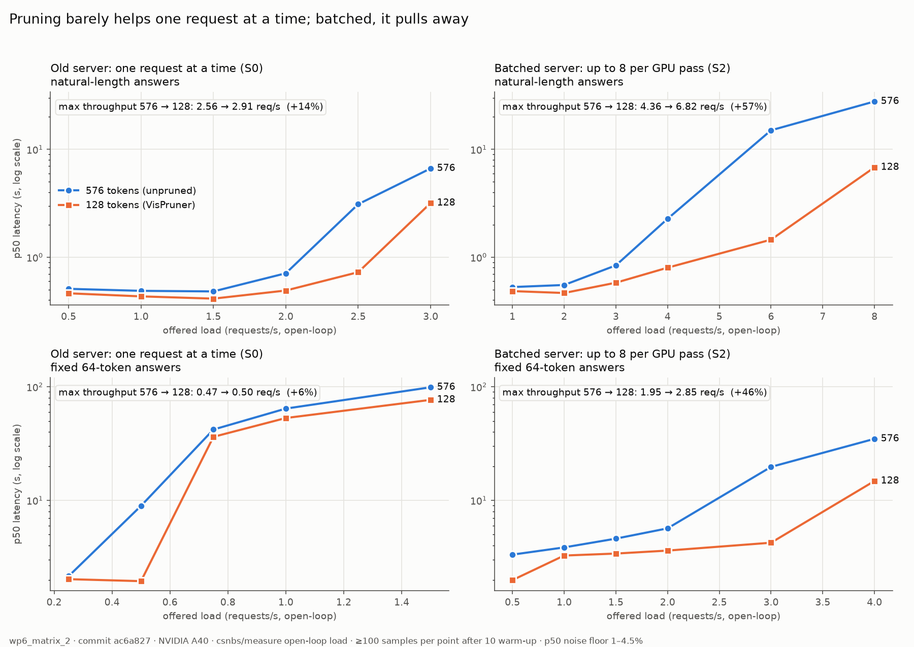

# Month-one results: how much of VisPruner's speedup survives serving (WP7)

Amay, 2026-10-25. Branch `amay/wp3-wp5-serving`, merged to `main`.

Every figure is labelled:
- **MEASURED**: straight from a run, with its file.
- **DERIVED**: arithmetic on measured values, shown.
- **PROVISIONAL**: measured under a known weakness.
- **HYPOTHETICAL**: not verified; never stated as an expectation.

---

## The answer in four sentences

1. One request at a time, pruning 576 → 128 visual tokens raises the server's maximum
   throughput by only **+6% (fixed 64-token answers) to +14% (natural-length answers)**,
   because decode dominates and pruning barely touches it.
2. In a batched server (up to 8 requests per GPU pass), the same pruning raises maximum
   throughput by **+46% (fixed) to +57% (natural)**.
3. Batching alone raises throughput **1.7–6×** depending on answer length; pruning's
   advantage only appears once batching is there.
4. A request queue without batching (S1) recovered **no measurable capacity**.

**Provenance.** The load-test numbers come from Rithvik's open-loop load generator
(`csnbs/measure`, unmodified), driven by `scripts/wp6_load_matrix.py`. Amay ran it; per
`CLAUDE.md`, Rithvik should rerun it or sign off before it appears in a public chart. The
request and the rerun command are in `kingcorsair/RITHVIK_LOADGEN_REQUESTS.md`.



---

## 1. The main result: WP6 load matrix (MEASURED)

Run `wp6_matrix_2`, commit `ac6a827`, NVIDIA A40, 74 blocks in seeded random order, 0 failed
requests. Every point has ≥110 post-warm-up samples. p99 is omitted everywhere because no
cell reaches 1,000 samples (rule 6). Torch is pinned to 4 threads in every server.

The run recorded `git_dirty=true`. The only uncommitted changes at launch were
`CLAUDE.md` and `Dockerfile` edits (committed afterwards in `39c0679`); the code was
exactly `ac6a827`.

Files: `results/timing/wp6_matrix/wp6_matrix_2/` (`summary.txt`, `summary.json`,
`wp6_demo_plots.png`, `wp6_capacity.png`, per-block GPU CSVs and loadgen logs).

**Maximum throughput** (highest achieved rate at any offered level):

| Server | Policy | 576 | 128 | Pruning's gain (DERIVED) |
|---|---|---|---|---|
| S0, one request at a time (`csnbs/server.py`) | fixed 64 tokens | 0.473 | 0.500 | **+6%** |
| S1, queue, no batching | fixed 64 tokens | 0.477 | 0.501 | +5% |
| S2, batched, B ≤ 8 | fixed 64 tokens | 1.950 | 2.848 | **+46%** |
| S0 | natural EOS | 2.560 | 2.907* | **+14%*** |
| S1 | natural EOS | 2.571 | 2.898* | +13%* |
| S2 | natural EOS | 4.355 | 6.816 | **+57%** |

\* S0/S1 at vtn=128, natural: the highest level tested (3.0 rps) achieved 2.91 with the
queue already growing (p50 3.2 s), so the true capacity may be slightly higher. Treat +14%
as approximate.

**Noise floor** (rule 8, MEASURED, same cell repeated in random positions):

| Cell | Repeats | p50 spread | p95 spread | Throughput |
|---|---|---|---|---|
| S0, 128, natural, 1 rps | 4 | 1.0% | 2.4% | 1.000 every time |
| S2, 128, natural, 3 rps | 4 | 4.5% | 10.4% | 2.977–2.984 |

The pruning effects under batching (+46–57%) and the batching effects (1.7–6×) are
far outside this noise. The one-at-a-time pruning effect (+6%) is small but consistent
with the offline scan below.

**Latency at a load the old server can't handle** (natural answers, 3 rps offered, MEASURED):

| | p50 | p95 |
|---|---|---|
| S0, 576 | 6.66 s | 15.71 s |
| S0, 128 | 3.18 s | 8.95 s |
| S2, 576 | 0.84 s | 2.49 s |
| S2, 128 | 0.59 s | 2.00 s |

---

## 2. Agreement with the offline batch scan

`results/wp5_validation/wp5_val_2.txt`, batched `generate()` with no server, fixed 64 tokens,
CUDA events, MEASURED:

| B | 576 | 128 | 128 / 576 |
|---|---|---|---|
| 1 | 0.48 req/s | 0.52 req/s | 1.07× |
| 8 | 2.05 | 3.01 | 1.47× |
| 16 | 2.69 | 4.52 | 1.68× |

Live under load at B ≤ 8 (fixed policy): 1.07× one at a time (S0: +6%) and 1.46× batched
(S2: +46%). **The offline scan and the live run agree** at the same batch size. The ~68%
figure quoted earlier is the B=16 offline number; the live server is capped at B=8.

---

## 3. Why: the mechanism (DERIVED from measured values)

- **One at a time, decode dominates.** At B=1 a fixed 64-token answer takes ~1.93–2.07 s
  (`wp5_val_2`). Each decode step reads all ~13.5 GB of weights; that cost is the same at
  576 and 128. Pruning shortens prefill and slightly shrinks per-step attention, so it moves
  the total by ~7%.
- **Batched, the weight reads are shared.** At B=8 the batch takes 2.65 s at 128 vs 1.93 s
  at B=1, so 8× the requests cost 1.4× the time. The weight-read cost per request drops
  ~6×, and what's left is the per-request cost: prefill over visual tokens, and attention
  over each request's KV cache, which holds its visual tokens. That is exactly what pruning
  cuts.
- **Natural answers show more pruning benefit than fixed ones** (+14% vs +6% at S0) because
  they are shorter (~0.4 s vs ~2 s), so prefill is a larger share. This is CLAUDE.md's R2
  ("benefit shrinks as output grows") seen from the other side.

---

## 4. The four claims, kept separate (roadmap WP7 §5)

1. **Pruning reduces compute.** Prefill 111.5 → 44.4 ms, −60.2% (MEASURED, profiling phase,
   pre-WP1 numbers). VisPruner's own effect.
2. **Pruning also costs something.** The diversity-selection loop makes `multimodal_prep`
   slower at 128 than at 576 (MEASURED in the profiling phase: 49.7 → 68.4 ms, FP32 tower).
   WP5 adds a small further cost: per-image selection costs ~5% of batch time at B=16
   (3368 → 3538 ms, `wp5_val_1` vs `wp5_val_2`).
3. **FP16 vision tower (WP2) is a generic optimisation.** Tower −58/−60% at both configs,
   end-to-end ~−2% (indicative only). All WP6 servers include it, so it is **not** part of
   any 576-vs-128 delta above.
4. **Queueing and batching are serving optimisations.** A throughput gain from batching is
   **not** evidence that VisPruner improved. The honest framing: *the pruned configuration
   leaves GPU capacity unused when requests are served one at a time; batching is what
   converts that into throughput.* The matrix shows each piece alone:

| | No batching (S0) | Batching (S2) |
|---|---|---|
| **No pruning (576)** | 2.56 req/s | 4.36 req/s (batching alone: 1.7×) |
| **Pruning (128)** | 2.91 req/s (pruning alone: +14%) | 6.82 req/s (both: 2.7×) |

(natural policy; fixed policy: 0.47 / 1.95 / 0.50 / 2.85.)

---

## 5. What did not work, or not as expected

- **WP4's queue (S1) recovered no capacity.** S1 vs S0: 2.571 vs 2.560 (576, natural),
  2.898 vs 2.907 (128), all within noise. WP3 had bounded the possible gain at 5–8% (the
  overlappable CPU work). Live, the overlap did not convert into throughput. **HYPOTHETICAL**
  causes, not tested: CPU prep threads competing with the GPU worker for the GIL and the
  ~7.65-CPU quota. The queue still mattered as the prerequisite for batching.
- **S1 adds a little single-request latency**, as the roadmap predicted: low-load p50
  509 → 523 ms (576), 463 → 476 ms (128), about +3% (MEASURED; the p50 noise floor at that
  cell is 1%).
- **The roadmap's founding utilisation premise did not reproduce at its original size.**
  The PROVISIONAL table had GPU utilisation 87.1% (576) vs 65.8% (128) at 3 rps, a
  21.3-point gap. Interleaved, with the thread pin, S0 at 3 rps natural measures **94.7% vs
  86.7%, an 8.0-point gap** (MEASURED). The direction holds; the size was mostly an artifact
  of the non-interleaved sweeps and/or the throttling stall. The priority order wasn't
  wrong, since batching did turn out to be where the capacity is, but the 21-point figure
  should not be quoted again.
- **Static batching's weakness is visible.** Batching's gain is 4.1× with fixed 64-token
  answers but only 1.7× with natural-length answers (576). Under natural EOS a batch runs
  until its longest answer finishes, and S0 is already faster on short answers. At low load
  S2 is slightly slower than S0 (natural, 576: p50 529 ms at 1 rps vs 488 ms). This is the
  argument for continuous batching (the optional vLLM port).
- **One batched answer in 540 differs from its single-request answer** (`wp5_val_2`): an
  EOS-timing difference from FP16 rounding, at 576, B=8. It is not contamination (tested);
  it is sent to Sribhav for a scoring check.

---

## 6. Correctness behind the numbers (MEASURED)

| Check | Result | File |
|---|---|---|
| S1 answers vs S0, 90 dev images | 90/90 at 576 and 128 | `results/wp5_validation/wp5_val_2.txt` |
| Batched (B=2/4/8) vs single, both configs | 539/540 identical | same |
| Kept-token set, batched vs single | identical on every image after the fix | same |
| Cross-request contamination | 10/10 anchors unchanged with any partner, either order, both configs | same |
| Batch-dependent selection, root cause | numerics, not mixing: 8 copies of one image agree 24/24 | `results/wp5_validation/wp5_seldiag_1.txt` |

Accuracy (not exact-text agreement) is Sribhav's: `kingcorsair/SRIBHAV_ACCURACY_REQUESTS.md`.

---

## 7. Status of every headline figure

| Figure | Status |
|---|---|
| Pruning +6% (fixed) / +14% (natural) one at a time; +46% / +57% batched | MEASURED, `wp6_matrix_2`; pending Rithvik's sign-off to be reportable |
| Batching 1.7× (natural) – 6× (fixed, 128) | MEASURED, `wp6_matrix_2` |
| Batched-scan 1.07× → 1.68× at B=16 | MEASURED offline, `wp5_val_2`; not a serving number |
| Mechanism explanation (decode shared by batching) | DERIVED |
| Gains hold on a production server (vLLM) | HYPOTHETICAL; see the optional vLLM plan in `AMAY_ENGINEERING_ROADMAP.md` |
| Gains hold with long answers (256+ tokens) | HYPOTHETICAL; expected to shrink (R2), untested |
| Pruning's accuracy cost | Sribhav's; requested |

---

## 8. Limits of this setup

- **Traffic:** evenly spaced arrivals (not bursty), the load generator on the same CPU-capped
  machine, no network, answers capped at 64 tokens, 90 dev items repeated. Relative
  comparisons are fair (every cell sees the same traffic, in random order); absolute
  numbers are optimistic. Improvements requested in `kingcorsair/RITHVIK_LOADGEN_REQUESTS.md`.
- **Server:** static batching, B ≤ 8, standard HuggingFace kernels, no paged KV.
- **Only one pruning level** (128). The 576 → 64 curve is not measured.
- **No KV-memory / max-concurrency measurement (R5).** GPU memory was sampled, but no run
  pushed memory to its limit.

---

## 9. Reproduce

```bash
python scripts/wp3_run_diag.py --run-id <id> && python scripts/wp3_analyze.py results/timing/wp3_diag/<id>
python scripts/wp5_batch_validation.py --run-id <id>
python scripts/wp5_selection_diag.py --run-id <id>
python scripts/wp6_load_matrix.py --run-id <id>          # ~3.3 h on an A40
python scripts/wp6_analyze.py results/timing/wp6_matrix/<id>
python scripts/wp6_plot.py results/timing/wp6_matrix/<id>
```

A clean-checkout rerun of every script (roadmap WP7 §5.3) has **not** been done; every
script above did run from the committed tree in this session.

---

## 10. Deferred to month two, with the evidence for each

| Item | Why | Evidence |
|---|---|---|
| **OPTIONAL — vLLM port** | Continuous batching, paged KV and fast kernels; tests the claim on a production server | Static batching's natural-EOS weakness (§5); plan in the roadmap |
| Poisson arrivals, off-box load generator, longer answers | Make traffic realistic; answer R2 | §8; Rithvik doc |
| Larger batch size (B=16) in the server | The offline scan shows the pruning gap widening (1.47× at B=8 → 1.68× at B=16) | `wp5_val_2` |
| Why S1 recovered nothing | The 5–8% WP3 bound didn't materialise | §5 |
| Decode roofline diagnostic | Decides whether CUDA graphs are worth 2–3 weeks | Roadmap "one diagnostic worth doing" |
